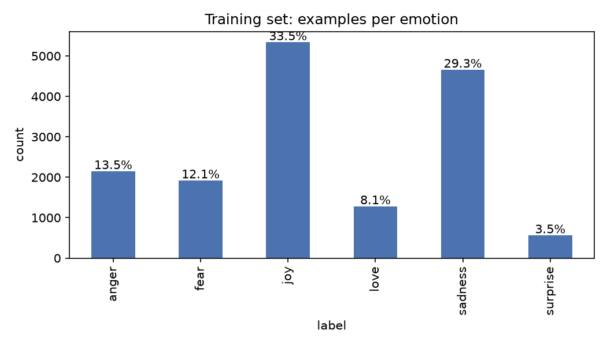
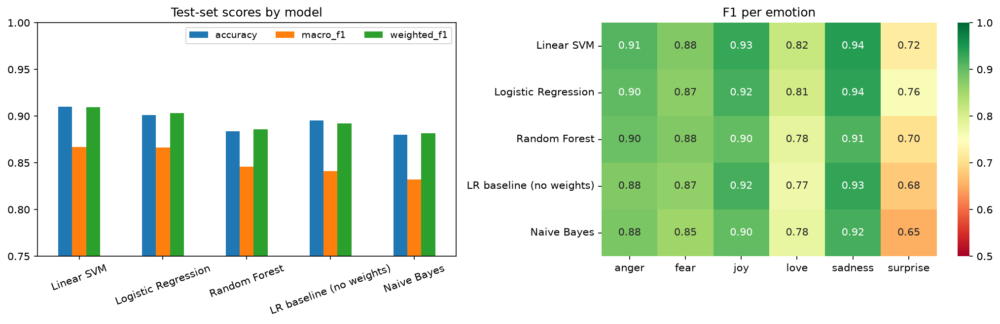
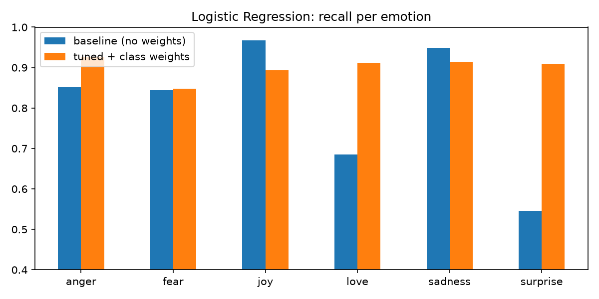

# 🎙️ VoxAid: Speech Emotion Support Assistant

VoxAid listens to what you say, works out the emotion behind your words, shows it, and answers with one or two comforting sentences, which it also speaks back to you.

**🌐 Live app:**  https://voxaid-ai.streamlit.app/

```
 🎤 voice ──► speech-to-text ──► text cleaning ──► emotion model ──► reply (1-2 comforting sentences) ──► 🔊 text-to-speech
              (Google Speech)    (Phase 1 rules)   (best model)       + detected emotion & confidence       (gTTS)
```

## 1. Problem statement
People often want to be heard before they want advice. VoxAid is a small assistant that recognises how a person feels from a spoken or typed sentence and answers with a short, kind, emotion-appropriate response. The core machine learning task is **6-class text emotion classification**: given an English sentence, predict *anger, fear, joy, love, sadness* or *surprise*.

## 2. Dataset
**CARER emotion dataset** (Saravia et al., 2018): short English texts (tweets) labelled with one of six emotions. After Phase 1 cleaning: **15,923 train / 1,993 val / 2,000 test** rows.

The classes are imbalanced, which shapes the whole project:

| joy | sadness | anger | fear | love | surprise |
|---|---|---|---|---|---|
| 33.5% | 29.3% | 13.5% | 12.1% | 8.1% | 3.5% |



## 3. Phase 1 summary (data preprocessing)
Done in the DS project; details in [`phase1/README.md`](phase1/README.md). Outputs are in `data/processed/`.
- Cleaned the text (lower case, letters only), removed duplicates, conflicting labels and texts shared between splits (no leakage).
- `text_ml`: stop words removed but **negations kept** ("not", "never", "cannot", ...).
- TF-IDF (5,000 unigram + bigram features) and padded sequences (10,000-word vocabulary, length 52), both **fitted on train only**.
- Computed balanced **class weights** and recommended **macro-F1** as the main metric.

| File | Contents |
|---|---|
| `train/val/test_clean.csv` | cleaned text, label, `is_length_outlier` |
| `train/val/test_processed.csv` | cleaned text, `text_ml`, label, `label_id`, numeric features |
| `tfidf_*.npz`, `tfidf_vectorizer.joblib` | TF-IDF features and fitted vectorizer |
| `seq_*.npy`, `vocab.json` | padded sequences for deep learning |
| `y_*.npy`, `label_mapping.json` | label ids (anger = 0 … surprise = 5) and class weights |

## 4. Phase 2: models
| Notebook | Models | Input |
|---|---|---|
| [`classification_ML.ipynb`](notebooks/classification_ML.ipynb) | LR baseline (no class weights), **Naive Bayes, Logistic Regression, Linear SVM, Random Forest** | TF-IDF |
| [`classification_DL.ipynb`](notebooks/classification_DL.ipynb) | **Feedforward NN, Bidirectional LSTM** | padded sequences |
| [`transformer.ipynb`](notebooks/transformer.ipynb) | **DistilBERT** fine-tuned | clean text, own tokenizer |
| [`model_comparison.ipynb`](notebooks/model_comparison.ipynb) | compares everything, measures response time, picks the app's model | results/*.json |

**Training and testing**
- The test set (2,000 rows) is held out and used once per model.
- ML models: hyperparameters tuned with **stratified 5-fold cross-validation** (3-fold for Random Forest) on train + val, scored on macro-F1.
- DL / transformer: trained on train, validation set for early stopping / best-epoch selection.
- **Class weights** are used in every model except the baseline, following Phase 1.

**Metrics:** accuracy, **macro-F1** (main), macro precision and recall, weighted F1, ROC-AUC (one-vs-rest), top-3 accuracy, per-class F1 and recall, confusion matrices, and response time per sentence.

## 5. Results
Test set, 2,000 sentences. *The DL and transformer rows are filled in after running those notebooks: `model_comparison.ipynb` prints this table ready to paste.*

| Model | Family | Accuracy | Macro-F1 | Weighted F1 | Surprise F1 |
|---|---|---|---|---|---|
| Linear SVM (calibrated) | Classical ML | 0.910 | **0.867** | 0.910 | 0.721 |
| Logistic Regression | Classical ML | 0.901 | 0.866 | 0.903 | 0.759 |
| Random Forest | Classical ML | 0.884 | 0.847 | 0.886 | 0.716 |
| LR baseline (no weights, first version) | Classical ML | 0.895 | 0.841 | 0.892 | 0.679 |
| Naive Bayes | Classical ML | 0.880 | 0.832 | 0.882 | 0.652 |
| Feedforward NN | Deep learning | 0.875 | 0.835 | 0.878 | 0.695 |
| BiLSTM | Deep learning | 0.902 | 0.869 | 0.904 | 0.792 |
| DistilBERT | Transformer | 0.931 | 0.884 | 0.930 | 0.709 |



**Effect of class weights (Logistic Regression):** recall on *surprise* went from **0.55 → 0.91** and on *love* from **0.69 → 0.91**, raising macro-F1 from 0.841 to 0.866, at the cost of a small drop in recall on *joy* (0.97 → 0.89).



**Response time** (one sentence, CPU, including preprocessing): Logistic Regression about 1 ms, Linear SVM about 5 ms, Random Forest about 70 ms.

More plots: confusion matrices, feature importance and training curves are in [`plots/`](plots/).

### Analysis
- **Best models:** linear models on TF-IDF are accurate, tiny (under 2 MB) and answer in milliseconds, which is ideal for a live app. Linear SVM and Logistic Regression are practically tied on macro-F1; the calibrated SVM has higher accuracy and precision, Logistic Regression has better recall on rare emotions.
- **Sequence models** (BiLSTM, DistilBERT) read word order and negation, which bag-of-words cannot; compare their rows above.
- **Where models fail:** the same confusions everywhere: *joy ↔ love*, *fear ↔ surprise*, *sadness ↔ anger*. These emotions are close, and CARER labels come from hashtags, so some are noisy. *Surprise* stays the hardest class (fewest examples).
- **Limits of the app:** the models only know short English tweets; long, mixed, sarcastic or Urdu/Roman-Urdu speech is out of scope, and speech-to-text errors add noise. The replies are fixed templates, not generated.
- **Improvements:** more data for rare emotions (augmentation, GoEmotions), multi-label output, a multilingual transformer for Urdu, using voice tone (audio features), and a safety-checked language model for more varied replies.

## 6. Web app
Folder [`app/`](app/): Streamlit.
- **Speak** (browser microphone, `st.audio_input`) or **type** how you feel.
- Speech → text with Google's free speech recognition (`SpeechRecognition`).
- The text is cleaned **exactly like Phase 1** (`app/voxaid_core.py`; verified to reproduce the Phase 1 files 100%) and classified by the chosen model (default: best macro-F1 model the app can load, from `results/best_model.json`).
- Shows the emotion, confidence and all six probabilities, then a reply: one line naming the emotion + 1-2 comforting sentences, spoken back with gTTS.
- If confidence is low it says so; if the words are unknown it asks the user to say more; if the text mentions self-harm it shows a support message pointing to helplines instead of a generic reply.
- The sidebar lets you switch models (ML always; LSTM / DistilBERT when TensorFlow / PyTorch and their model files are present).

No API keys are needed.

## 7. How to run
```bash
git clone <your-repo-url>
cd VOXAid-Project-main
python -m venv .venv
# Windows: .venv\Scripts\activate     macOS/Linux: source .venv/bin/activate
pip install -r requirements.txt
```
1. **Train the models** by running the notebooks in `notebooks/` in this order (Run All): `classification_ML.ipynb` (about 5 min) → `classification_DL.ipynb` → `transformer.ipynb` (GPU recommended, e.g. Google Colab) → `model_comparison.ipynb`. The models go to `models/`, metrics to `results/`, plots to `plots/`.
2. **Start the app** from the repo root:
   ```bash
   streamlit run app/app.py
   ```
   Open http://localhost:8501. The app works with just the ML models; voice input and the spoken reply need an internet connection.

### Deploy (Streamlit Community Cloud)
1. Commit the trained ML models (`models/ml/*.joblib` except Random Forest) and `results/` and push to GitHub.
2. On share.streamlit.io: **New app** → your repo → main file path `app/app.py` → Advanced settings → Python 3.11.
3. The cloud reads `app/requirements.txt` (lightweight, ML models only). Paste the live link at the top of this README.

## 8. Repository structure
```
VOXAid-Project-main/
├── phase1/                  Phase 1 summary (put the Phase 1 notebook here)
├── data/processed/          Phase 1 outputs used by Phase 2
├── notebooks/               Phase 2: ML, DL, transformer, final comparison
├── models/                  trained models (created by the notebooks)
├── results/                 metrics as JSON + best_model.json
├── plots/                   ml/, dl/, transformer/, comparison/
├── app/                     website: app.py, voxaid_core.py, requirements.txt
├── requirements.txt         full environment
└── README.md
```

## 9. Conclusion
VoxAid shows that a complete voice-to-comfort pipeline can be built from a classic NLP dataset. Following the Phase 1 recommendations (class weights, macro-F1, leakage-free features) made the models much fairer to rare emotions: *surprise* recall went from 0.55 to 0.91 without hurting overall accuracy. A tuned linear model recognises the emotion in about 9 of 10 sentences in a few milliseconds and under 2 MB, enough for a free, instant web app; sequence models and transformers can add accuracy when more compute is available. The main open problems are close emotion pairs, noisy labels and the English-only, text-only input. VoxAid is a student project, not a mental-health service.
